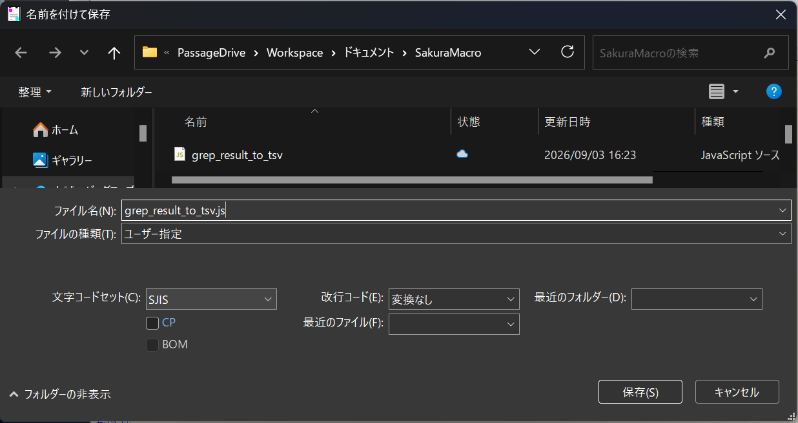
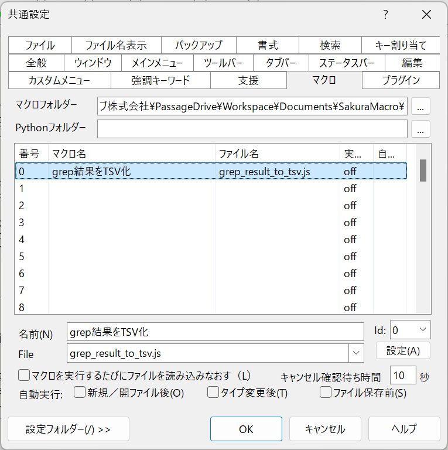
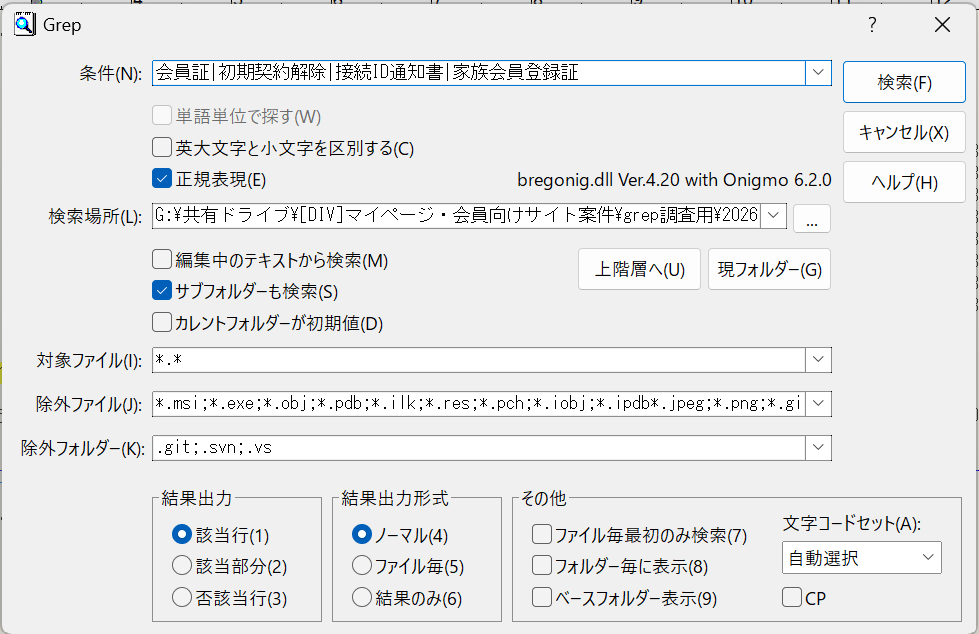

# サクラエディタのマクロを利用したgrep調査・スプレッドシート転記手順書

## 1. 本手順書の目的

本手順書では、サクラエディタのgrep機能とJavaScriptマクロを使用して、grep調査結果をGoogleスプレッドシートへ転記する方法を説明します。

従来は、grep結果に対して次の作業を手動で行っていました。

- ファイルパス先頭の不要部分を削除する
- ファイル情報と該当行の内容を分ける
- スプレッドシートに貼り付けられるようタブを追加・削除する
- 各行に一致したgrep対象文字列を入力する
- 検索結果がなかった文字列に「なし」を入力する

今回導入するマクロを利用すると、これらの作業を自動化できます。

最終的な作業は、概ね次の流れになります。

1. シート単位で、対象リポジトリを順番にgrepする
2. すべてのgrep結果を同じ結果画面に残す
3. マクロを1回実行する
4. 自動生成されたデータをスプレッドシートへ貼り付ける

---

# 2. マクロを利用するとできること

このマクロは、サクラエディタに表示されているgrep結果を読み取り、スプレッドシートへ貼り付けられる形式へ変換します。

主に、次の処理を自動的に行います。

- grep結果から検索対象のリポジトリ名を取得する
- `_master_AP_...` より後ろの日付やIDをサービス名から除外する
- ファイルパスを検索対象フォルダからの相対パスへ変換する
- ファイル情報と該当行の内容を別々の列に分割する
- 該当行に含まれるgrep対象文字列を判定する
- 1行に複数の検索文字列が含まれる場合、すべて記録する
- 検索結果がない文字列について、「grep結果」列へ「なし」を設定する
- 検索結果が0件だったリポジトリについても「なし」の行を作る
- スプレッドシートへ貼り付けられる6列のデータを作る
- 完成したデータをWindowsのクリップボードへコピーする

---

# 3. 出力される列

マクロは、次の6列に対応したデータを生成します。

| 列 | 項目 | 出力内容 |
|---|---|---|
| A列 | grep対象文字列 | 該当行に含まれていた検索文字列 |
| B列 | grep結果 | ヒットした場合は空欄、ヒットしなかった場合は「なし」 |
| C列 | サービス（画面） | 対象リポジトリ名 |
| D列 | 空欄 | 常に空欄 |
| E列 | ファイル | 相対パス、行番号、列番号、文字コード |
| F列 | 該当行の内容 | grepで見つかったソースコードや文章 |

例えば、次のgrep結果があったとします。

```text name=grep-result-example.txt
G:\共有ドライブ\...\perl基盤（newmember）_master_AP_00010654_20260803205123\newmember\cgi-bin\common\os_libcom.pl(501,4)  [EUC]: # 会員証再発行の希望
```

マクロを実行すると、次の内容に変換されます。

| grep対象文字列 | grep結果 | サービス（画面） | 空欄 | ファイル | 該当行の内容 |
|---|---|---|---|---|---|
| 会員証 |  | perl基盤（newmember） |  | `\newmember\cgi-bin\common\os_libcom.pl(501,4) [EUC]:` | `# 会員証再発行の希望` |

---

# 4. 初回のみ行うマクロの導入

以下の作業は、基本的に最初の1回だけ実施します。

## 4.1 マクロ保存用フォルダを作る

任意の場所に、サクラエディタのマクロを保存するフォルダを作成します。

保存場所の例は次のとおりです。

```text name=macro-folder-example.txt
C:\Users\ユーザー名\Documents\SakuraMacro
```

---

## 4.2 マクロファイルを作成する

1. サクラエディタを起動します。
2. 新しいファイルを開きます。
3. 提供されたマクロコードをすべて貼り付けます。
4. メニューから「ファイル」→「名前を付けて保存」を選択します。
5. ファイル名に、次の名前を入力します。

```text name=macro-file-name.txt
grep_result_to_tsv.js
```

6. 文字コードセットに「SJIS」を指定します。
7. 4.1で作成したフォルダへ保存します。

### 保存時の重要な注意点

#### 拡張子「.js」を忘れない

Windowsの設定によっては、既知の拡張子が表示されないことがあります。エクスプローラーの「表示」設定で「ファイル名拡張子」を表示し、`.js.txt` になっていないことを確認してください。

#### 文字コードはSJISを指定する
以下のようになっていればいい。


---

## 4.3 サクラエディタにマクロを登録する

1. サクラエディタを開きます。
2. メニューから「設定」を選択します。
3. 「共通設定」を開きます。
4. 「マクロ」タブを選択します。
5. 「マクロフォルダー」に、マクロファイルを保存したフォルダを指定します。
6. マクロ一覧から、使用していない番号を選択します。
7. 「名前」に任意のマクロ名を入力します。

例：

```text name=registered-macro-name.txt
grep結果をTSV化
```

8. 「File」で、作ったファイルを指定します。
9. 「設定」ボタンを押します。
10. 「OK」を押して共通設定を閉じます。



---

## 4.4 マクロが登録されたことを確認する

1. サクラエディタのメニューから「ツール」を選択します。
2. 「登録済みマクロ」を開きます。
3. 登録したマクロ名が表示されることを確認します。

表示されていれば、マクロの初期設定は完了です。

---

# 5. grep調査を行う単位

## 5.1 grepはスプレッドシートの1シート単位で行う

grep調査は、**スプレッドシートの1シートを1単位**として実施します。

例えば、スプレッドシートに次のシートがあるとします。

```text name=spreadsheet-sheet-example.txt
perl_mem（山口）
```

そのシートの上部に、次の対象リポジトリが記載されている場合、

```text name=perl-mem-target-repositories.txt
対象リポジトリ
perl基盤（mem1_common）
perl基盤（newmember）
perl基盤（option）
```

次の3つのフォルダを順番にgrepし、**同じgrep結果画面に残します**。

- `perl基盤（mem1_common）`
- `perl基盤（newmember）`
- `perl基盤（option）`

3つすべてのgrepが完了した後で、マクロを1回だけ実行します。

---

## 5.2 シートが変わったらgrep結果も分ける

別のシートを調査するときは、前のシートのgrep結果と混ぜないようにします。

例えば次の2つは、別々に処理します。

- `perl_mem（山口）`
- `scpf_mem（山口）`

---

# 6. grep調査の実施

## 6.1 調査依頼から検索文字列を確認する

例えば、次の調査依頼が来たとします。

```text name=grep-request-example.txt
「会員証」
「初期契約解除」
「接続ID通知書」
「家族会員登録証」
```

サクラエディタのgrep条件には、各検索文字列を半角の縦線 `|` でつないで入力します。

```text name=grep-condition-example.txt
会員証|初期契約解除|接続ID通知書|家族会員登録証
```

`|` は正規表現において「または」を意味します。

したがって、この条件は次の意味になります。

- 「会員証」を含む行
- または「初期契約解除」を含む行
- または「接続ID通知書」を含む行
- または「家族会員登録証」を含む行

---

## 6.2 grep画面を開く

1. サクラエディタを開きます。
2. メニューから「検索」を選択します。
3. 「Grep」を選択します。

---

## 6.3 grep条件を入力する

「条件」に、調査対象の文字列を正規表現で入力します。

---

## 6.4 grep設定を確認する

次のように設定します。

| 設定項目 | 設定内容 |
|---|---|
| 英大文字小文字を区別する | オフ |
| 正規表現 | オン |
| サブフォルダーも検索 | オン |
| 除外ファイルに、画像ファイルの拡張子追加 | 例：*.jpeg;*.png;*.gif;*.svg |
他はデフォルト設定


## 6.5 検索対象フォルダを指定する

スプレッドシート上部の「対象リポジトリ」を確認し、対応するGドライブ上のフォルダを指定します。

例えば、対象リポジトリが次の場合、

```text name=target-repository.txt
perl基盤（newmember）
```

次のようなフォルダを指定します。

```text name=target-repository-folder.txt
G:\共有ドライブ\[DIV]マイページ・会員向けサイト案件\grep調査用\20260801取得\perl基盤（newmember）_master_AP_00010654_20260803205123
```


---

## 6.6 検索を実行する

設定を確認したら、検索を実行します。

検索完了後、サクラエディタにgrep結果が表示されます。

ヒットがある場合は、次のような結果になります。

```text name=grep-hit-example.txt
G:\共有ドライブ\...\fixed(app)_master_AP_00010109_20260801103713\app\src\View\Unbundle\Signup\result.twig(32,24)  [UTF-8]: <p>4日〜7日ほどで会員証等をお届けします。</p>
197 個が検索されました。
```

ヒットがない場合は、次のように表示されます。

```text name=grep-no-hit-example.txt
0 個が検索されました。
```

---

# 7. 同じシートの対象リポジトリを続けて検索する
## 7.1 対象リポジトリをすべて検索する

シート上部の「対象リポジトリ」に記載されたフォルダを、すべて順番に検索します。

例えば `perl_mem（山口）` の場合、次の3つをすべて検索します。

1. `perl基盤（mem1_common）`
2. `perl基盤（newmember）`
3. `perl基盤（option）`

すべての検索が完了するまで、マクロは実行しません。

3つすべてのgrep結果が同じ画面内にあることを確認してから、マクロを実行します。

---

# 8. マクロの実行手順

## 8.1 マクロを実行する画面を確認する

マクロは、**grep結果が表示されている画面で実行**してください。

実行前に、次を確認してください。

- 調査対象のgrep結果が表示されている
- 同じシートの対象リポジトリをすべて検索済み
- 別シートの検索結果が混ざっていない
- 0件だった対象リポジトリの検索条件とフォルダー情報も残っている

---

## 8.2 登録済みマクロを実行する

1. サクラエディタのメニューから「ツール」を選択します。
2. 「登録済みマクロ」を選択します。
3. 登録したマクロを選択します。

---

## 8.3 検索文字列を入力する

マクロを実行すると、検索文字列の入力画面が表示されます。

サクラエディタのgrepで使用した条件と同じ文字列を入力します。

例：

```text name=macro-keyword-input.txt
会員証|初期契約解除|接続ID通知書|家族会員登録証
```

### 入力時の注意点

- grepで使用した条件と同じ順番で入力する
- 半角の `|` で区切る

例えば次の条件は、4つの検索文字列として扱われます。

```text name=parsed-keywords-example.txt
会員証
初期契約解除
接続ID通知書
家族会員登録証
```

---

## 8.4 完了メッセージを確認する

正常に処理が完了すると、次の情報を含む完了メッセージが表示されます。

- 出力行数
- 解析したgrep結果の行数
- 対象サービス数
- スキップした行数

完了メッセージが表示された時点で、スプレッドシート貼り付け用のデータがWindowsのクリップボードへコピーされています。

ファイルとして保存する必要はありません。

---

# 9. Googleスプレッドシートへの貼り付け

## 9.1 貼り付け先のシートを開く


## 9.2 表の左上セルを選択する


## 9.3 貼り付ける


# 10. マクロの出力例

## 10.1 検索文字列がヒットした場合

次のようなgrep結果がある場合、

```text name=grep-hit-source.txt
G:\共有ドライブ\...\fixed(app)_master_AP_00010109_20260801103713\app\src\View\Unbundle\Signup\result.twig(32,24)  [UTF-8]: <p>4日〜7日ほどで会員証等をお届けします。</p>
```

次のように出力されます。

| grep対象文字列 | grep結果 | サービス（画面） | 空欄 | ファイル | 該当行の内容 |
|---|---|---|---|---|---|
| 会員証 |  | fixed(app) |  | `\app\src\View\Unbundle\Signup\result.twig(32,24) [UTF-8]:` | `<p>4日〜7日ほどで会員証等をお届けします。</p>` |

---

## 10.2 一部の検索文字列だけヒットしなかった場合

例えば `fixed(app)` で次の3語だけが見つかったとします。

- 会員証
- 初期契約解除
- 接続ID通知書

「家族会員登録証」が1件も見つからなかった場合、次の行が自動的に追加されます。

```tsv name=fixed-app-no-hit.tsv
家族会員登録証	なし	fixed(app)			
```

---

## 10.3 対象リポジトリ全体で0件だった場合

`fixed(package)` の検索結果が0件だった場合、4つの検索文字列すべてについて「なし」が出力されます。

```tsv name=fixed-package-no-hits.tsv
会員証	なし	fixed(package)			
初期契約解除	なし	fixed(package)			
接続ID通知書	なし	fixed(package)			
家族会員登録証	なし	fixed(package)			
```

スプレッドシート上では次のようになります。

| grep対象文字列 | grep結果 | サービス（画面） |
|---|---|---|
| 会員証 | なし | fixed(package) |
| 初期契約解除 | なし | fixed(package) |
| 接続ID通知書 | なし | fixed(package) |
| 家族会員登録証 | なし | fixed(package) |

---

## 10.4 同じ行に複数の検索文字列がある場合

例えば次の行が見つかったとします。

```text name=multiple-keywords-source.txt
会員証と接続ID通知書を再発行します。
```

この場合、同じファイル・同じ行を2行に重複させず、A列に一致した文字列をまとめて出力します。

```tsv name=multiple-keywords-output.tsv
会員証、接続ID通知書		fixed(app)		\app\example.twig(10,1)  [UTF-8]:	会員証と接続ID通知書を再発行します。
```

この行により、次の2つは両方ともヒット済みとして扱われます。

- 会員証
- 接続ID通知書

そのため、この2語について「なし」の行は作られません。

---

# 11. 技術的な解説

## 11.1 マクロとは何か

マクロとは、アプリケーション上で行う定型作業を自動化する機能です。

今回のマクロは、サクラエディタで実行できるJScript、つまりJavaScript形式で記述されています。

人が手動で行っていた次の作業を、プログラムが代わりに実行します。

1. grep結果全体を取得する
2. 結果を1行ずつ確認する
3. 各行からファイルパスと内容を分ける
4. 該当する検索文字列を調べる
5. 検索結果がなかった文字列を調べる
6. スプレッドシート用の列を作る
7. 完成した内容をクリップボードへコピーする

マクロを使用しても、元のソースファイルを書き換えることはありません。

今回のマクロが読み取るのは、サクラエディタ上に表示されたgrep結果です。

---

## 11.2 マクロはどのように動いているか

マクロは、概ね次の順番で処理しています。

### 1. 現在の文書全体を取得する

マクロを実行した時点で開かれているgrep結果を、すべて選択して読み取ります。

そのため、マクロは必ずgrep結果の画面で実行する必要があります。

### 2. 検索文字列の入力を受け取る

入力された次の条件を、

```text name=macro-input-processing.txt
会員証|初期契約解除|接続ID通知書|家族会員登録証
```

`|` で分割し、4つの検索文字列として保持します。

### 3. grep結果を1行ずつ解析する

サクラエディタのgrep結果を、改行ごとに分割します。

その後、各行について次のどれに該当するかを判断します。

- 検索条件の行
- 検索対象の行
- フォルダーの行
- 除外ファイルの行
- 除外フォルダーの行
- 検索オプションの行
- 実際のgrep結果の行
- 「○個が検索されました。」という集計行

検索条件や集計行は、スプレッドシートへの出力対象から除外されます。

### 4. サービス名を取得する

次のフォルダ名から、

```text name=service-folder-name.txt
fixed(package)_master_AP_00010110_20260801111910
```

`_master_AP_...` より前を取り出します。

```text name=service-name.txt
fixed(package)
```

これを、スプレッドシートのC列「サービス（画面）」へ出力します。

### 5. 相対パスを作る

次のフルパスから、

```text name=full-grep-path.txt
G:\共有ドライブ\...\fixed(app)_master_AP_00010109_20260801103713\app\src\View\sample.twig(10,2) [UTF-8]:
```

検索対象フォルダまでの部分を削除します。

```text name=relative-grep-path.txt
\app\src\View\sample.twig(10,2) [UTF-8]:
```

これをE列の「ファイル」に出力します。

### 6. 該当行の内容を取り出す

ファイル情報より後ろにあるソースコードや文章を取り出し、F列へ出力します。

タブ文字が残っていると、スプレッドシート上で別の列に分かれてしまいます。そのため、該当行の中にあるタブは半角スペースへ変換します。

### 7. 一致した検索文字列を調べる

各grep結果行に対して、入力された検索文字列を1つずつ確認します。

例えば、該当行が次の場合、

```text name=keyword-detection-example.txt
会員証と接続ID通知書を再発行します。
```

次の2語が一致したと判断します。

- 会員証
- 接続ID通知書

A列には、次のようにまとめて出力します。

```text name=combined-keywords.txt
会員証、接続ID通知書
```

### 8. ヒットしなかった検索文字列を調べる

サービスごとに、各検索文字列が1回以上見つかったかを記録します。

例えば `fixed(app)` で「家族会員登録証」が1回も見つからなければ、次の行を追加します。

```tsv name=not-found-result.tsv
家族会員登録証	なし	fixed(app)			
```

### 9. 0件のフォルダも処理する

実際のgrep結果が0件の場合、ファイルの結果行は存在しません。

ただし、grep結果には次のフォルダー情報が残っています。

```text name=zero-result-folder.txt
フォルダー G:\共有ドライブ\...\fixed(package)_master_AP_00010110_20260801111910
```

マクロはこの行から `fixed(package)` を取得します。

そのため、0件のフォルダについても、すべての検索文字列を「なし」として出力できます。

### 10. クリップボードへコピーする

すべての処理が完了すると、マクロは生成したデータをWindowsのクリップボードへコピーします。

そのため、完了後はスプレッドシートで `Ctrl + V` を押すだけで貼り付けられます。

---

## 12.3 TSVとは何か

TSVは「Tab-Separated Values」の略です。

日本語では「タブ区切り形式」と呼ばれます。

データの各列を、タブ文字で区切って表現します。

例えば、次の1行では各項目の間にタブが入っています。

```tsv name=tsv-example.tsv
会員証		fixed(app)		\app\sample.twig(10,2) [UTF-8]:	会員証を発送します。
```

これをGoogleスプレッドシートへ貼り付けると、タブの位置で列が分かれます。

| A列 | B列 | C列 | D列 | E列 | F列 |
|---|---|---|---|---|---|
| 会員証 |  | fixed(app) |  | `\app\sample.twig(10,2) [UTF-8]:` | 会員証を発送します。 |

CSVがカンマで列を区切るのに対し、TSVはタブで列を区切ります。

今回TSVを使用する理由は、ソースコードや文章内にカンマが含まれていても、列が分裂しにくいためです。

### 実際にはTSVファイルを保存していない

今回のマクロは、`.tsv` ファイルをディスク上に作成するものではありません。

正確には、**TSV形式に整えた文字列をクリップボードへコピー**しています。

利用者はファイルを開いたり保存したりする必要はなく、そのままスプレッドシートへ貼り付けられます。

---

# 13. コードの主な処理

マクロ内の主な関数と役割は次のとおりです。

| 関数名 | 役割 |
|---|---|
| `runConversion` | マクロ全体の処理を制御する |
| `getDocumentText` | 現在のgrep結果全体を取得する |
| `parseKeywords` | 入力された検索条件を `|` で分割する |
| `parseResultLine` | grep結果からサービス名、ファイル、内容を取得する |
| `addService` | サービス名を重複しないように登録する |
| `detectServiceFromFolderLine` | 「フォルダー」行からサービス名を取得する |
| `normalizeServiceName` | フォルダ名とスプレッドシート上の表記差を補正する |
| `findMatchedKeywords` | 該当行に含まれるすべての検索文字列を取得する |
| `cleanContent` | 該当行内の余分な空白やタブを整える |
| `detectServiceFromHeader` | フォルダー情報を取得する予備処理 |
| `isHeaderLine` | 検索条件などのヘッダー行を除外する |
| `makeTsv` | 6列のデータをTSV形式に変換する |
| `sanitizeCell` | セル内のタブや改行を除去する |
| `trimText` | 文字列の前後にある空白を除去する |

---

# 14. 注意事項

## 14.1 grep条件とマクロ入力条件を同じにする

grepで次を指定した場合、

```text name=grep-and-macro-condition.txt
会員証|初期契約解除|接続ID通知書|家族会員登録証
```

マクロにも同じ条件を入力してください。

入力条件が異なると、次の問題が発生します。

- 正しい検索文字列を判定できない
- ヒットしているのに「なし」と表示される
- grep結果行がスキップされる

---

## 14.2 複雑な正規表現は使用しない

このマクロは、`|` を検索文字列の区切りとして処理します。

次のような単純なOR条件を使用してください。

```text name=recommended-regular-expression.txt
会員証|初期契約解除|接続ID通知書|家族会員登録証
```

次のような複雑な正規表現は、マクロで正しく検索語へ分割できない可能性があります。

```text name=unsupported-regular-expression.txt
(会員|家族会員)証|接続(ID|ＩＤ)通知書
```

複雑な正規表現が必要な場合は、マクロの仕様変更が必要です。

---

## 14.3 シート単位を守る

1つのgrep結果画面には、同じスプレッドシートへ貼り付ける対象リポジトリだけを含めてください。

異なるシートの対象を混ぜないでください。

---

## 14.4 0件でもgrep結果を残す

0件の対象リポジトリも、検索自体を省略しないでください。

マクロは、grep結果上の「フォルダー」行を見て対象リポジトリを判断します。

検索を実行していないフォルダについては、マクロも存在を認識できません。

---

## 14.5 元のソースファイルは変更されない

このマクロは、grep結果を読み取ってクリップボードへコピーするだけです。

Gドライブ上のソースファイルに対して、次の操作は行いません。

- 編集
- 上書き
- 削除
- 移動
- 名前変更

---

## 14.6 貼り付け後に確認する

マクロによって多くの手作業を省略できますが、最終結果については目視確認を推奨します。

最低限、次を確認してください。

- 対象リポジトリ数が正しいか
- 「なし」の対象が正しいか
- サービス名が正しいか
- ファイルパスが途中で切れていないか
- 該当内容がF列に入っているか
- 異なるシートの結果が混ざっていないか

---

# 15. トラブルシューティング

## 15.1 登録済みマクロに表示されない

確認事項：

- マクロフォルダーが正しいか
- `grep_result_to_tsv.js` がマクロフォルダー内にあるか
- ファイル名が `.js.txt` になっていないか
- 共通設定でマクロ名とファイルを登録したか
- 共通設定の「設定」ボタンを押したか

---

## 15.2 「終了していないコメントです」と表示される

マクロファイルの中に、コード以外の文字やMarkdown記号が入っている可能性があります。

次を確認してください。

- コードの前に説明文が入っていないか
- コードの開始・終了を示すバッククォートが入っていないか
- 文字コードがSJISになっているか
- ファイルが途中までしか保存されていない状態になっていないか

---

## 15.3 「オブジェクトを指定してください」と表示される

必要な関数がコード内に存在しない、またはコードの一部だけを置き換えた可能性があります。

部分的に修正せず、最新版のコード全体でファイルを置き換えてください。

---

## 15.4 「サービス名を判定できません」と表示される

次を確認してください。

- grep結果画面でマクロを実行しているか
- grep結果に「フォルダー」行が残っているか
- 対象フォルダ名に `_master_AP_` が含まれているか
- grep結果を手動で削除していないか

判定できない場合は、表示された入力画面にサービス名を手動で入力できます。

例：

```text name=manual-service-name.txt
perl基盤（newmember）
```

---

## 15.5 0件のリポジトリが出力されない

0件だったリポジトリの「フォルダー」行が、grep結果画面に残っているか確認してください。

次のような情報が必要です。

```text name=required-zero-result-header.txt
フォルダー G:\共有ドライブ\...\fixed(package)_master_AP_00010110_20260801111910
0 個が検索されました。
```

`0 個が検索されました。` だけでは、どのリポジトリが0件だったか判定できません。

---

## 15.6 一部の結果が「スキップ」と表示される

完了画面の「スキップ」は、マクロがスプレッドシートへ出力しなかった行数です。

主な原因は次のとおりです。

- 入力した検索文字列とgrep条件が異なる
- grep結果の形式が通常と異なる
- grep結果ではない文章が同じ画面に入っている
- パスに `_master_AP_` が含まれていない
- 行番号・列番号・文字コードの表示形式が異なる

スキップ数が多い場合は、貼り付け結果と元のgrep結果を比較してください。

---

## 15.7 スプレッドシートで列がずれる

次を確認してください。

- A列の最初の空欄セルから貼り付けたか
- セルを編集している状態ではなく、セル自体を選択して貼り付けたか
- 貼り付け前に別の文字列をコピーしていないか
- 完了メッセージの後でそのまま貼り付けたか

---