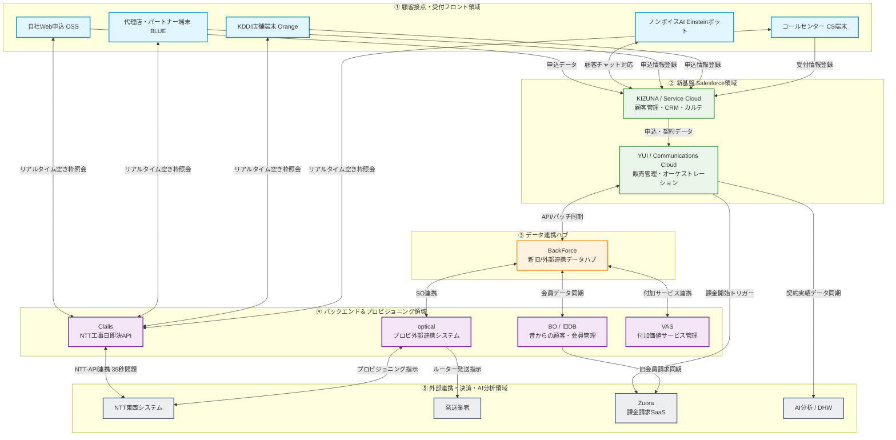
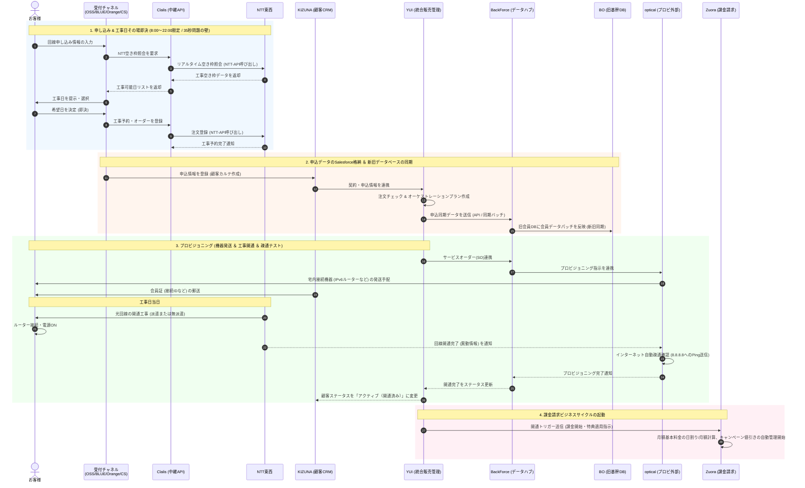
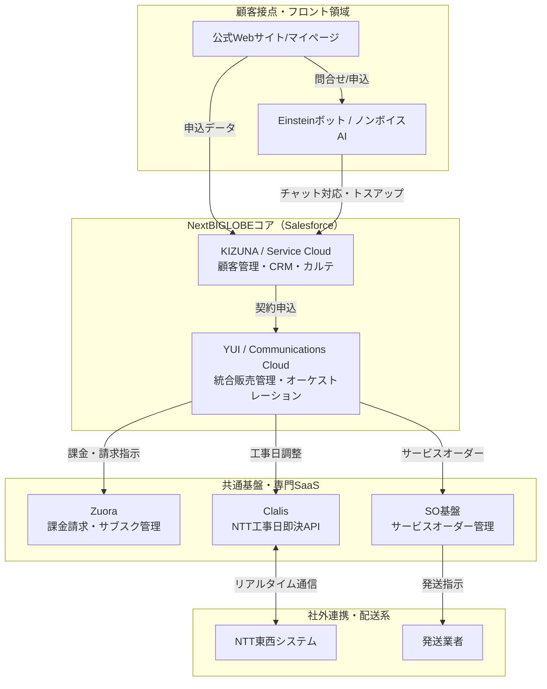
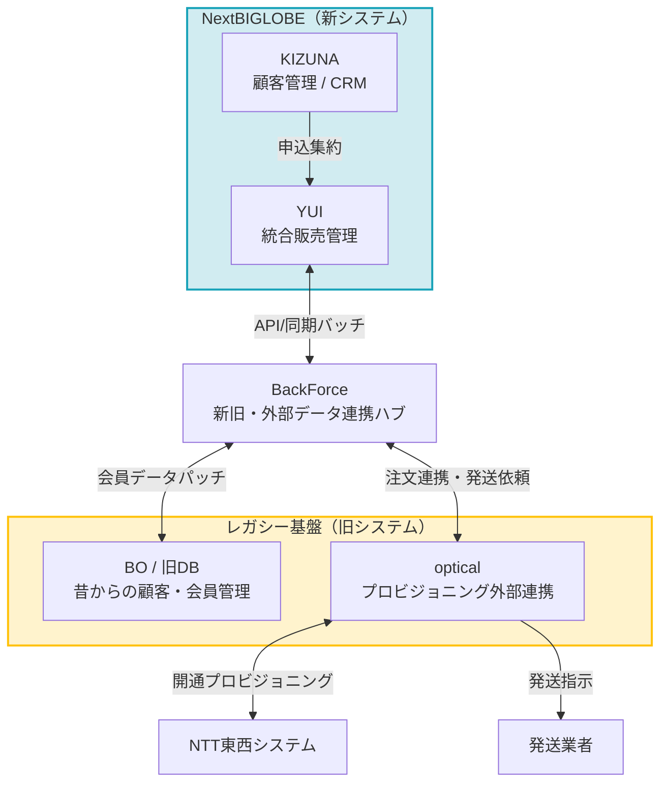

# BIGLOBE社内システム（情シス系）新入社員向け解説ガイド
〜申し込みからアカウント開通・請求開始までのリアルと理想〜

新入社員のみなさん、BIGLOBEへようこそ！
このガイドは、私たちが日々お客様に届けているインターネット接続サービス（ビッグローブ光など）の裏側で、**どのような社内システムが、どのように連携して動いているか**を分かりやすく解説した研修用ドキュメントです。

現在、BIGLOBEは「NextBIGLOBE」と呼ばれる大規模な社内システム変革を行っています。昔からの古いシステム（レガシー）と、最先端のSalesforce（SaaS）ベースのシステムがどのようにハイブリッドに連携しているか、データの旅路を追いかけながら紐解いていきましょう！

---

## 1. 【全体システム連携マップ】現行システムが織りなす構造
まずは、当社の社内システム（情シス系）の全体像を俯瞰してみましょう。
以下のフローチャートは、受付窓口となる「顧客接点フロント」から、中核となる「Salesforce領域」、新旧システムを繋ぐ「中継ハブ」、そして「バックエンド・外部連携・AI分析領域」まで、**現在動いている主要システムがどのゾーンに属し、どう繋がっているか**を一望できるようにまとめたマップです。

---

## 2. 申し込みから開通・課金開始までの【全体データ連携シーケンス図】
システム全体マップを頭に入れたところで、次は**「お客様が申し込んでから、インターネットが繋がり、課金（請求）が開始されるまで」**のデータの旅路を、時系列（シーケンス図）で追ってみましょう！

現在BIGLOBEで稼働しているすべての主要システムが、裏側でどのように「会話」しているかがひと目でわかります。

---

## 3. フロー図のステップ別詳細解説

### 【STEP 1】 申し込みと工事日即決 (ゴールデンルート：GR)
*   **処理内容:** 
    お客様が窓口からビッグローブ光を申し込む際、中継APIシステムである「Clalis」を介して、NTT東西の空き工事枠をリアルタイムに確認。その場で希望の工事日を確定（即決）させます。
*   **現場で絶対に覚えておきたい情シスTIPS:**
    *   **「8:00〜22:00」の壁:** NTT東西のAPIが夜間停止するため、Clalisによる即決機能もこの時間帯しか動きません。時間外の申込は「非即決」となり、後日コンタクトセンターからの電話調整が必要です。
    *   **恐怖の「35秒問題」:** NTTのシステムにオーダーを取り次ぐ際、APIレスポンスに最大「35秒」を要する仕様があります。システムがフリーズしたわけではないため、新入社員のみなさんは開発・テスト時に「35秒」のウェイトが発生することを必ず覚えておいてください。

### 【STEP 2】 申込データの格納と新旧データベース同期
*   **処理内容:** 
    確定した申込情報は、Salesforce内の顧客管理システム「KIZUNA」で一括して受領され、そこから販売管理システム「YUI」に送られます。「YUI」がオーケストレーション（各システムへの自動処理の差配）を実行。データハブ「BackForce」を通じて、レガシーDBである「BO」へ会員データパッチをあて、プロビ外部連携の「optical」へオーダーを流します。
*   **現場で絶対に覚えておきたい情シスTIPS:**
    *   新システムであるSalesforce(YUI)と、旧システム(BO、optical)が並行して動いているため、まれに「新旧DB間でのデータの不整合」が発生することがあります。これを解消するのもアジャイル開発部やシステム運用チームの大切な仕事です。

### 【STEP 3】 各種ハガキ・接続機器の発送と受け取り
*   **処理内容:** 
    会員作成完了に伴い、お客様に接続用IDが記載された「会員証」が郵送されます（紙を希望されない場合は電子メール/マイページ提供）。同時に「optical」が発送管理システムと連携し、開通当日に必要なIPv6対応ルーターなどの宅内接続機器を発送します。

### 【STEP 4】 回線開通工事と疎通テスト
*   **処理内容:** 
    工事日にNTTの工事業者が回線を通します。その後、お客様がルーターをご自身で接続・電源ONにすることで、自動的にプロビジョニングが完了。opticalはネットワークの正常動作確認（8.8.8.8などのパブリックDNS宛て疎通テスト等）を行い、完了通知をYUIへ返します。これをもって、お客様の契約状態は「申込中」から「完了（アクティベーション成功）」に遷移します。

### 【STEP 5】 課金請求処理の開始 (Zuoraの起動)
*   **処理内容:** 
    開通完了通知を受け取ったYUIは、課金請求専門のグローバルSaaS「Zuora」に開通トリガーを送信します。Zuoraは会員情報・商品契約情報・特典情報（キャッシュバックや月額割引）を読み込み、日割り計算や初回月額基本料、初期工事費などの課金ログを自動生成します。ここからお客様の「ビジネスライフサイクル」が動き出します。

---

## 4. 情シス系システムの構造（現実と理想）

BIGLOBEのシステムを理解するもう一つのポイントは、**「これまでの古いスパゲッティ状態（As-Is）」から「Salesforceを中心としたシンプルな状態（To-Be / NextBIGLOBE）」への変革のロードマップ**を知ることです。

### ① 【理想：To-Be】NextBIGLOBEのシンプルアーキテクチャ
NextBIGLOBEでは、顧客接点（フロント）から、販売管理、各種プロビジョニング、そして共通基盤までをSalesforce（および一部専門SaaS）で一元的に統合・管理する形を目指しています。

### ② 【現実：As-Is / ハイブリッド】新旧システムが絡み合うリアルな構造
現在は変革の途中のため、最新のSalesforceベースの「KIZUNA」「YUI」と、従来からの基幹データベース「BO」、スクラッチで開発された外部連携システム「optical」が**BackForce**などのハブを介して複雑に連携しながら稼働しています。

---

## 5. 主要システムの役割と詳細解説

新入社員のみなさんが、実際の業務や会議、仕様書で遭遇する主要なシステム・用語の解説です。これらを頭に入れておくだけで、会議の理解度や仕様書の読み込み速度が劇的に上がります！

| システム名 | 今回追加 | 世代 | 役割と詳細 | 新人が覚えておきたいTIPS |
| :--- | :---: | :---: | :--- | :--- |
| **KIZUNA** | - | 新世代 | Salesforce **Service Cloud**ベース。 BIGLOBEの顧客管理・CRMの心臓部。取引先管理や「お客様カルテ（問い合わせ履歴・契約履歴）」の役割を持つ。 | 「オブジェクト」（テーブルのようなもの）単位でデータ構造が異なるので、まずは主要オブジェクトの意味から覚えていきましょう。 |
| **YUI** | - | 新世代 | Salesforce **Communications Cloud**ベース。 統合販売管理システム。フロントと基盤を結ぶ。各サブシステムがバラバラに持っていた販売・契約管理をYUIに集約する。 | 複雑な「オーケストレーション（全体処理の自動制御）」により、プロビジョニング状況を一目で可視化できます。 |
| **BO** (Back Office) | - | レガシー | Salesforce導入以前からBIGLOBEを支えている、昔からの顧客情報・会員管理・決済情報などが格納されている基幹データベース。 | 昔から契約しているお客様のデータは現在もここで管理されており、新システム(Salesforce)とのデータ同期が極めて重要です。 |
| **BackForce** | ✔ | 連携ハブ | 新システム(Salesforce)と、旧レガシーシステム(BO)や外部システム群の間に立ち、APIやバッチを使ってデータの受け渡し・同期をコントロールするハブ。 | 新旧システムのスパゲッティ化を防ぐための、頼れる「中継ハブ」です。 |
| **optical** | ✔ | レガシー | プロビジョニング（開通）外部連携システム。スクラッチ（手作り）で開発され、NTT東西や発送業者などの社外システムと直接やりとりする。 | 実処理は非常に複雑で、長年のノウハウが詰まったブラックボックスに近いシステムです。順次YUI等に権限を移行中。 |
| **Clalis** (クラリス) | - | 新世代 | NTT東西のシステムと接続し、工事日をその場で確定（即決）させるためのAPI中継システム。 | センター担当者が手動で行っていたNTT手配を自動化し、コールセンターの負担を劇的に減らした救世主。 |
| **BLUE** | ✔ | フロント周り | Salesforce内で動作し、Clalisを経由してNTTの工事日を取得・即決するためのソフトウェア（販売パートナー工事日即決システム）。 | 通称は「bIGLOBE User Entry」。代理店や開通センターなどで、スタッフが工事日を即決する際に活躍します。 |
| **Orange** (オレンジ) | ✔ | フロント周り | KDDIの店舗（auショップや家電量販店等）のタブレット受付システムから、Clalisをたたいて工事日即決を可能にするシステム。 | 通称は「OPeRation Next aGe」。KDDIとのアライアンス（提携）を技術で支える重要な連携システムです。 |
| **Zuora** | ✔ | 新世代 | グローバル標準のサブスクリプション課金請求SaaS。複雑なキャンペーン（特典割引、工事費分割、解約時の違約金など）を柔軟に管理・課金計算する。 | これまでの独自開発だった複雑な課金計算システムから、Zuoraへの移行を進めています。 |
| **Einsteinボット** (ノンボイスAI) | ✔ | 新世代 | Salesforce上で動くAIチャットボット。Webサイトで自動一次応答や、適切な有人オペレーター窓口へのルーティングを行う。 | 「からくり」というAIチャットボット製品もありますが、EinsteinボットはSalesforceと密結合し、顧客データを直接参照できる強みがあります。 |
| **VAS** (Value Added Service) | - | レガシー | IPv6、ひかりTV、U-NEXTなど、回線に付随する「付加価値サービス」の販売・管理システム。 | 回線商品とセットで販売されることが多いですが、仕様が大変複雑で、社内でも「ブラックボックス」と呼ばれることが多いです。 |

---

## 6. まとめ：新入社員の皆さんへ

BIGLOBEのシステム開発は、**「新しくてイケてるSalesforce(KIZUNA/YUI)」と「長年会社を支え続けているレガシー(BO/optical)」を組み合わせながら、いかにお客様の体験（CX：Customer Experience）を向上させるか**の戦いでもあります。

システム間の連携はスパゲッティのように見えるかもしれませんが、
*   フロントの顧客カルテは **KIZUNA**
*   販売や手続きの流れは **YUI**
*   APIによる工事日即決は **Clalis**
*   裏側の古い会員管理DBは **BO**
*   課金請求は **Zuora**

という主要なシステムたちの「会話（連携）」が頭の中でつながると、業務の解像度は一気に上がります。

わからないことがあったら、最初は「なんじゃらほい」でも全く構いません。開発やテスト、運用を通じて、この巨大なパズルを一緒に解き明かしていきましょう！
